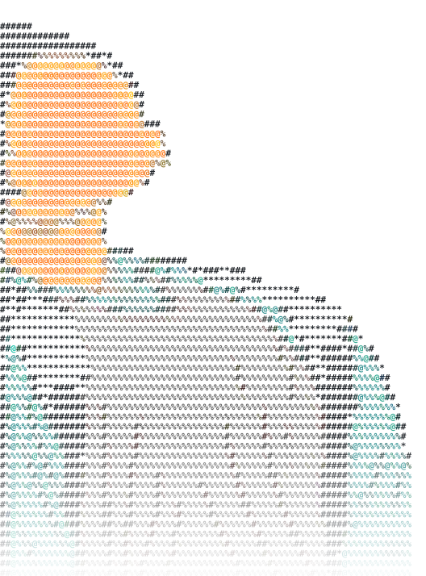

<picture>
  <source media="(prefers-color-scheme: dark)" srcset="./assets/ascii-dark.svg">
  <source media="(prefers-color-scheme: light)" srcset="./assets/ascii-light.svg">
  
</picture>

### Hi, I'm Rahmat

I build software end to end, from smart contracts to the interface people actually touch. Mostly where Web3 meets AI agents, plus plain, useful apps for real communities.

### Open source

When a tool I use has a bug, I try to fix it upstream instead of working around it. That got my first patches into [Hyperledger Fabric](https://github.com/hyperledger/fabric/pulls?q=is%3Apr+author%3Arhmatzeka+is%3Amerged), where I fixed a peer crash in gossip discovery, and into [Fabric-X](https://github.com/hyperledger/fabric-x-orderer/pulls?q=is%3Apr+author%3Arhmatzeka+is%3Amerged). I've sent 9 pull requests to AMD's [GAIA](https://github.com/amd/gaia/pulls?q=is%3Apr+author%3Arhmatzeka+is%3Amerged) and 11 to the XSS scanner [Dalfox](https://github.com/hahwul/dalfox/pulls?q=is%3Apr+author%3Arhmatzeka+is%3Amerged), and one change to [gortex](https://github.com/zzet/gortex/pulls?q=is%3Apr+author%3Arhmatzeka+is%3Amerged) brought its indexer's peak memory down from 968 MB to 503 MB. Smaller fixes went into [viem](https://github.com/wevm/viem/pulls?q=is%3Apr+author%3Arhmatzeka+is%3Amerged), [repowise](https://github.com/repowise-dev/repowise/pulls?q=is%3Apr+author%3Arhmatzeka+is%3Amerged) and [ECC](https://github.com/affaan-m/ECC/pulls?q=is%3Apr+author%3Arhmatzeka+is%3Amerged).

 
 
 

<picture>
  <source media="(prefers-color-scheme: dark)" srcset="./assets/stack-dark.svg">
  <source media="(prefers-color-scheme: light)" srcset="./assets/stack-light.svg">
  
</picture>
